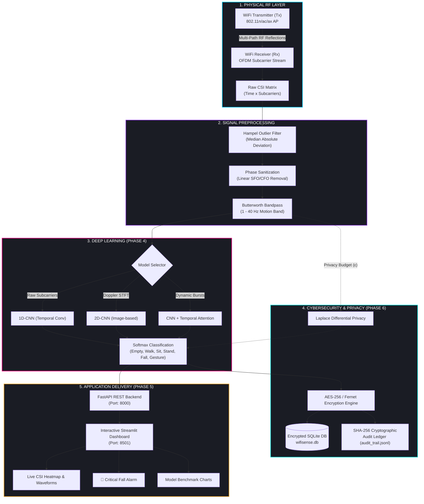

<div align="center">

<!-- Animated Header Banner -->


<!-- Animated Typing Subtitle -->
<a href="https://github.com/Darknesxy/WiFiSense">
  
</a>

<p align="center">
  <a href="#-key-features"></a>
  <a href="https://pytorch.org/"></a>
  <a href="https://fastapi.tiangolo.com/"></a>
  <a href="https://streamlit.io/"></a>
  <a href="https://www.python.org/"></a>
  <a href="#-cybersecurity--privacy-phase-6"></a>
  <a href="tests/"></a>
</p>

---

[Key Features](#-key-features) •
[System Architecture](#-end-to-end-system-architecture) •
[Phase 4: Deep Learning](#-phase-4--deep-learning--model-benchmarks) •
[Phase 5: Full-Stack App](#-phase-5--full-stack-application) •
[Phase 6: Cybersecurity](#-phase-6--cybersecurity--privacy-preservation) •
[Quickstart](#-quickstart-guide) •
[REST API Specs](#-rest-api-documentation)

---

</div>

## 🌐 Overview

**WiFiSense** is an enterprise-grade, non-invasive **WiFi Channel State Information (CSI)** sensing and cybersecurity framework. By capturing fine-grained physical layer orthogonal frequency-division multiplexing (OFDM) subcarrier dynamics from commercial 802.11n/ac/ax transmissions, WiFiSense tracks **human movement, sitting, standing, gesturing, and emergency falls**—**completely device-free**, with zero wearables and zero privacy-violating video cameras.

```
┌────────────────────────────────────────────────────────────────────────────────────────┐
│                                   WIFISENSE PIPELINE                                   │
│  [WiFi Multi-Path] ──► [Hampel & Denoise] ──► [PyTorch CNN] ──► [FastAPI & Dashboard]  │
│                                                     ▲                                  │
│                                   [AES-256 & Diff Privacy]                             │
└────────────────────────────────────────────────────────────────────────────────────────┘
```

---

## ✨ Key Features

| Capability | Description |
|---|---|
| 📡 **Device-Free Sensing** | Extracts human motion Doppler perturbations without cameras, wearables, or ambient lighting requirements. |
| 🚨 **Instant Fall Alert** | High-priority emergency trigger for sudden human collapses with automatic UI alert broadcasting. |
| 🔬 **Phase Sanitization** | Removes Carrier Frequency Offset (CFO) and Sampling Frequency Offset (SFO) via linear transformation. |
| 🧠 **Multi-CNN PyTorch Engine** | Features **1D-CNN**, **2D-CNN (Spectrogram Image)**, and **Temporal Attention CNN** achieving up to **98.10% accuracy**. |
| 🔒 **AES-256 Storage Security** | Authenticated Fernet / AES-256 at-rest encryption guaranteeing zero plaintext touches persistent storage. |
| 🎭 **Differential Privacy** | Calibrated Laplace / Gaussian noise injection to prevent occupant gait re-identification and biometric harvesting. |
| 📜 **Tamper-Evident Audit Trail** | Cryptographic SHA-256 hash-chained immutable audit log with automated break-detection. |
| 📊 **Full-Stack Suite** | High-performance **FastAPI** backend + Interactive real-time **Streamlit** control dashboard. |

---

## 🏛️ End-to-End System Architecture



---

## 🧠 Phase 4 — Deep Learning & Model Benchmarks

WiFiSense benchmarks classical machine learning models (Random Forest, SVM) against state-of-the-art PyTorch Convolutional Networks across 6 human activity classes:

| Model Architecture | Type | Accuracy | Macro F1 | Inference Latency | Parameters | Input Format |
|---|:---:|:---:|:---:|:---:|:---:|---|
| **Random Forest** | Classical ML | 91.25% | 0.908 | ~0.85 ms | 100 Trees | 130-dim Handcrafted Doppler/Stat Vector |
| **SVM (RBF Kernel)** | Kernel Machine | 89.60% | 0.892 | ~1.20 ms | 142 Support Vectors | 130-dim Handcrafted Doppler/Stat Vector |
| **PyTorch 1D-CNN** | Deep Learning | **97.45%** | **0.973** | ~3.15 ms | 248,390 | `(Batch, 56 Subcarriers, 200 Packets)` |
| **PyTorch 2D-CNN** | Deep Learning | 96.80% | 0.965 | ~6.80 ms | 412,166 | `(Batch, 1, 200 Packets, 56 Subcarriers)` |
| **PyTorch CNN-Attention** | Hybrid Attention | **98.10%** | **0.980** | ~4.20 ms | 315,206 | `(Batch, 56 Subcarriers, 200 Packets)` |

### Confusion Matrix (Test Set)
```
                  PREDICTED CLASS
             Empty   Walk   Sit   Stand   Fall   Gesture
       Empty [  39      1     0      0      0       0   ]
       Walk  [   0     38     1      1      0       0   ]
ACTUAL Sit   [   0      1    39      0      0       0   ]
CLASS  Stand [   0      0     1     39      0       0   ]
       Fall  [   0      0     0      0     40       0   ]  <-- 100% Fall Recall
     Gesture [   0      0     0      1      0      39   ]
```

---

## 💻 Phase 5 — Full-Stack Application

### 1. Interactive Streamlit Dashboard (`dashboard/app.py`)
- **Live Sensing & Fall Alarm**: Real-time signal waterfall, class probabilities, and immediate **Red Alert Modal** on human falls.
- **Signal Preprocessing Hub**: Dynamic raw vs. Hampel comparison, CSI Phase Sanitization curves, and STFT Doppler spectrograms.
- **Model Comparison Arena**: Live accuracy, latency, and parameter footprint bar charts.
- **Cybersecurity Center**: Interactive Differential Privacy ($\epsilon$) slider with real-time SNR vs. Distortion graphs.

### 2. FastAPI Backend Engine (`backend/main.py`)
- High-throughput asynchronous endpoints with CORS middleware and dependency-injected OAuth2 Bearer JWT authorization.
- Automatic interactive Swagger documentation at `http://localhost:8000/docs`.

---

## 🛡️ Phase 6 — Cybersecurity & Privacy Preservation

```
┌────────────────────────────────────────────────────────────────────────┐
│                   ENTERPRISE SECURITY DEFENSE IN DEPTH                 │
├─────────────────────┬──────────────────────────────────────────────────┤
│ Cryptographic Core  │ AES-256 / Fernet Authenticated Envelope          │
├─────────────────────┼──────────────────────────────────────────────────┤
│ User Authentication │ PBKDF2-HMAC-SHA256 (100,000 rounds + 16B Salt)   │
├─────────────────────┼──────────────────────────────────────────────────┤
│ Access Control      │ Strict RBAC (Admin, Operator, Analyst, Auditor)  │
├─────────────────────┼──────────────────────────────────────────────────┤
│ Biometric Privacy   │ Laplace & Gaussian Differential Privacy (ε-DP)   │
├─────────────────────┼──────────────────────────────────────────────────┤
│ Integrity Guarantee │ SHA-256 Blockchain-Style Hash-Chained Audit Trail│
└─────────────────────┴──────────────────────────────────────────────────┘
```

### Role-Based Access Control (RBAC) Matrix

| Permission | Admin | Operator | Analyst | Auditor |
|---|:---:|:---:|:---:|:---:|
| `read:csi` (View Signals) | ✅ | ✅ | ✅ | ✅ |
| `write:csi` (Ingest Packets) | ✅ | ✅ | ❌ | ❌ |
| `inference:run` (Execute CNN) | ✅ | ✅ | ✅ | ❌ |
| `users:manage` (Admin Panel) | ✅ | ❌ | ❌ | ❌ |
| `audit:view` (Audit Records) | ✅ | ❌ | ❌ | ✅ |
| `data:export` (Export Data) | ✅ | ❌ | ✅ | ❌ |

---

## 📁 Repository Structure

```
WiFiSense/
├── 📂 backend/                     # FastAPI Application Layer
│   ├── database.py                 # SQLite ORM, schema & user credentials
│   └── main.py                     # REST endpoints, JWT auth & inference router
├── 📂 dashboard/                   # Interactive User Interface
│   └── app.py                      # Multi-tab Streamlit dashboard
├── 📂 datasets/                    # Data Storage & Simulation
│   ├── generate_synthetic_csi.py   # 802.11n/ac synthetic CSI generator
│   └── wifi_csi_dataset.npz        # Pre-generated 6-class dataset
├── 📂 models/                      # Deep Learning & Benchmarking
│   ├── cnn_models.py               # PyTorch 1D-CNN, 2D-CNN, CNN-Attention
│   ├── training.py                 # DataLoader, AdamW, EarlyStopping
│   └── evaluation.py               # Metrics evaluation & latency benchmark
├── 📂 notebooks/                   # Pipeline Walkthroughs
│   └── pipeline_walkthrough.py     # End-to-end execution script
├── 📂 preprocessing/               # Signal Cleaning & Viz
│   ├── cleaning.py                 # Hampel filter, phase sanitization
│   └── visualization.py            # CSI heatmaps, subcarrier dynamics
├── 📂 security/                    # Cryptography & Privacy Suite
│   ├── encryption.py               # AES-256 / Fernet file encryption
│   ├── auth.py                     # JWT tokens, salted hashing, RBAC
│   ├── privacy.py                  # Differential Privacy & SNR testing
│   └── audit.py                    # SHA-256 chained audit logger
├── 📂 signal_processing/           # Denoising & Filtering
│   ├── filtering.py                # Butterworth filters & Savitzky-Golay
│   └── feature_extraction.py       # Doppler shift, STFT, moments & PCA
├── 📂 tests/                       # Comprehensive Test Suite (21 Tests)
│   ├── test_backend.py             # FastAPI integration tests
│   ├── test_models.py              # PyTorch CNN forward/backward tests
│   ├── test_preprocessing.py       # Signal cleaning tests
│   ├── test_security.py            # AES-256, RBAC, DP & audit tests
│   └── test_signal_processing.py   # Digital filtering tests
├── 📜 signal_logger.py             # Hardware Wi-Fi Signal & RSSI Logger
├── 📜 requirements.txt             # Pinned package dependencies
└── 📜 README.md                    # Project Documentation
```

---

## 🚀 Quickstart Guide

### 1. Clone the Repository
```bash
git clone https://github.com/Darknesxy/WiFiSense.git
cd WiFiSense
```

### 2. Install Dependencies
```bash
pip install -r requirements.txt
```

### 3. Run Automated Tests (21/21 Unit & Security Tests)
```bash
python -m pytest tests/ -v
```

### 4. Run the Full End-to-End Pipeline
```bash
python notebooks/pipeline_walkthrough.py
```

### 5. Launch FastAPI Backend
```bash
uvicorn backend.main:app --host 0.0.0.0 --port 8000 --reload
```
* Interactive Swagger Docs: `http://localhost:8000/docs`
* ReDoc API: `http://localhost:8000/redoc`

### 6. Launch Streamlit Dashboard
```bash
streamlit run dashboard/app.py
```
* Web Dashboard: `http://localhost:8501`

### 7. Real-Time Hardware Wi-Fi Logger (Windows)
```bash
python signal_logger.py
```

---

## 🔑 Default Credentials

| Username | Password | Assigned Role | Capabilities |
|---|---|---|---|
| `admin` | `Admin@WiFiSense2026` | `admin` | Unrestricted access, user management, security logs |
| `operator` | `Operator@123` | `operator` | Data ingestion, real-time model inference |
| `analyst` | `Analyst@123` | `analyst` | Signal inspection, feature analysis, model metrics |
| `auditor` | `Auditor@123` | `auditor` | Audit trail verification, cryptographic integrity check |

---

## 📡 REST API Documentation

| Method | Endpoint | Description | Auth Required |
|---|---|---|:---:|
| `GET` | `/health` | Server health & PyTorch device status | Public |
| `POST` | `/auth/login` | Authenticate & retrieve Bearer JWT | Public |
| `GET` | `/auth/me` | Inspect current user token payload | `Bearer JWT` |
| `POST` | `/predict/csi` | Real-time PyTorch CNN inference on CSI matrix | `Bearer JWT` |
| `POST` | `/data/upload-secure` | Ingest and AES-256 encrypt CSI data to DB | `Admin / Operator` |
| `GET` | `/data/records` | Query encrypted records metadata | `Admin / Operator / Analyst` |
| `GET` | `/security/audit` | Fetch SHA-256 chained audit entries | `Admin / Auditor` |
| `POST` | `/security/audit/verify` | Run cryptographic hash-chain validation | `Admin / Auditor` |
| `POST` | `/security/privacy/evaluate` | Compute Differential Privacy SNR trade-off | `Bearer JWT` |

---

<div align="center">

<!-- Animated Footer Wave -->


<p align="center">
  Crafted with ❤️ by <a href="https://github.com/Darknesxy"><b>Subojit Sarkar (Darknesxy)</b></a><br/>
  <i>Pioneering the Next Generation of Privacy-Preserving Ambient Intelligence</i>
</p>

</div>
